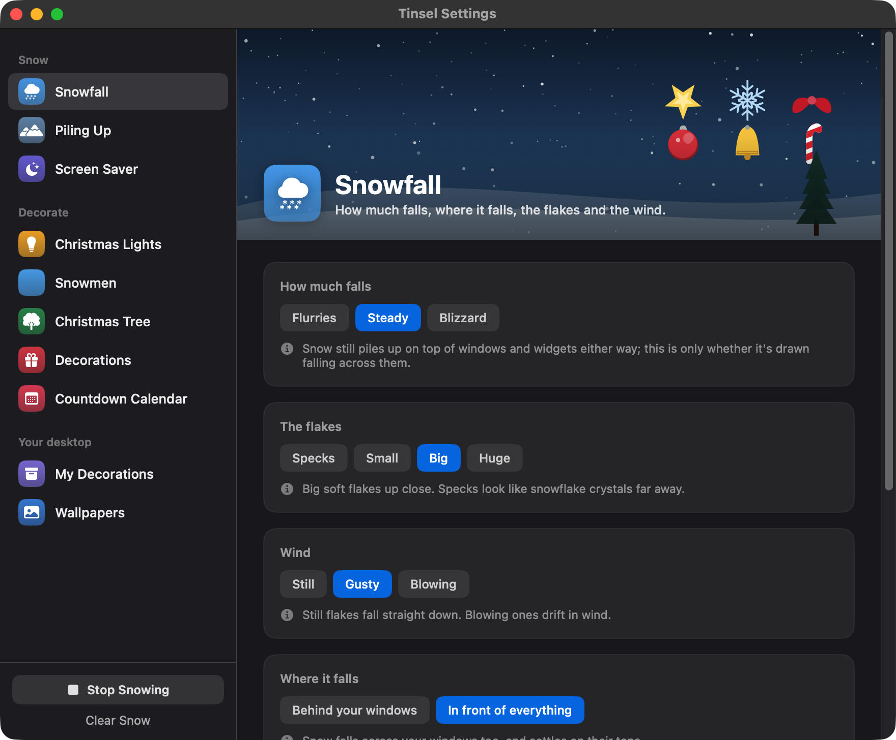
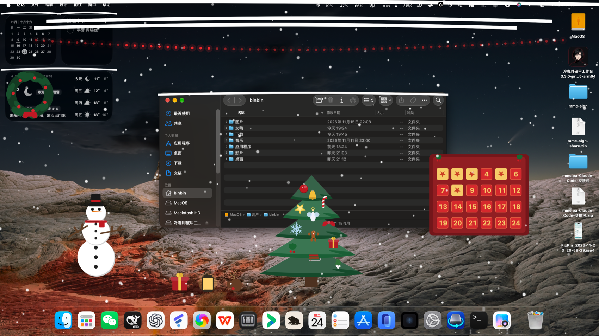

# Tinsel

**Deck your desktop.** Tinsel is a menu-bar app for macOS 14 and later that
winters your screen: snow falls behind your windows, settles on things, and
freezes into icicles; you can string lights along the windows you use, build a
snowman, put up a tree, hang ornaments, open an advent calendar and set a
Christmas desktop picture — all without a single image asset in the bundle,
because every decoration is drawn live with Core Graphics.

It is a small, MIT-licensed app you can build yourself in one command.

```bash
git clone https://github.com/CarzyBilly/tinsel.git
cd tinsel
./scripts/build-app.sh --verify     # builds dist/Tinsel.app and runs the checks
open dist/Tinsel.app
```

Requires macOS 14+, Xcode command line tools (Swift 5.9+). No dependencies,
no network access, no telemetry, no sandbox entitlement needed.

## What it does

### Snow

* **Snowfall** — three amounts (flurries, steady, blizzard), four flake sizes
  (specks to huge), three winds (still, gusty, blowing), and two places to
  fall: *behind your windows* (a snowy wallpaper that never piles up) or *in
  front of everything*. A separate, quieter layer snows behind your windows all
  day if you want it.
* **Piling up** — snow accumulates along the bottom of the screen and on the
  tops of the windows you have open; a dusting or deep drifts, slowly or
  quickly. Grab a window and shake it to knock the snow off. Icicles hang from
  window tops and drip.
* **Screen saver** — after 1–60 minutes away, the snow picks up and (optionally)
  the screen darkens and snow fills the menu bar. On return the leftovers melt
  or the screen stays dimmed, your choice. It waits while video is playing and
  can be limited to December–February.

### Lights

Six looks (Classic, Big Retro, Warm White, Icy Blue, Mini, Candy Cane), six
twinkle patterns (steady, alternate, chase, wave, slow fade, blink), speed,
sparse or packed bulbs, and a color picker. Click a window and the string runs
along its top; it follows the window as you drag it. Strings can also be tacked
anywhere on the desktop.

### Snowmen

Roll snowballs onto the desktop or onto a window's top, one on top of another,
as many as you like. Then dress it: top hat, beanie, Santa hat, earmuffs,
scarf, mittens, bow tie, pipe, coal, carrot, stick arms, broom, bucket,
pinecone, rock. Each piece snaps to the right size and can be dragged anywhere
on the snowman. There is a ready-made snowman too.

### A tree and decorations

Put up a tree, resize it, and hang any of eighteen ornaments on it — baubles,
bells, candy canes, stars, angels, bows, holly, mistletoe, sleds, snowflakes,
gingerbread, lanterns, presents, reindeer, stockings, wreaths, icicles and bare
trees. Presents, lanterns and reindeer stand in the snow; stockings, holly and
wreaths hang wherever you click. Drag to move, scroll or drag the green grip to
resize, drag the round handle to turn, right-click to take away.

### Countdown calendar

A 24-door advent board. One more door opens each day from the day you hang it;
in December every door up to today is ready. Opened doors are remembered, a
locked door tells you how many sleeps are left, and Christmas Eve brings
something special.

### My Decorations

Save what is up as a look ("Christmas Eve", "the office"), put everything away
and bring it back later, take everything down, rename or delete looks.

### Wallpapers

Thirty-one Christmas desktop pictures — villages, cabins, lamplit streets,
lakes, aurora, mountains, city windows — painted at your display's resolution
and set on every display with one click. Your old picture is one System
Settings change away.

### The menu bar

A snowflake in the menu bar with **Stop Snowing / Let It Snow**, **Clear Snow**,
**Settings…**, **Put Away / Bring Back Decorations**, **Put Up Something…** and
**Quit**. Hide the snowflake from the Screen Saver pane if you prefer no icon.

## How it works

```
Sources/Tinsel
├── main.swift          entry point, offscreen render modes
├── App.swift           app delegate, menu bar item, screen-saver timer, wallpapers
├── Model.swift         settings, decorations, looks, persistence
├── Snow.swift          flake simulation, drifts, icicles, window snow caps
├── Overlay.swift       the transparent windows above/below other windows
├── Art.swift           every ornament, snowman piece, tree and calendar, in vectors
├── Lights.swift        light-string geometry, twinkle, hit testing
├── Placement.swift     placing, dragging, resizing, rotating, advent clicks
├── WindowTracker.swift other apps' windows via Accessibility, plus advent rules
├── SettingsUI.swift    settings window, sidebar, banners, control widgets
├── Panes.swift         the ten settings panes
├── Wallpapers.swift    31 procedural scenes
├── Demo.swift          `--demo`: dress the desktop for a screenshot
└── Diagnostics.swift   `--selftest`, `--render-samples`, `--render-icon`
```

Three details worth knowing:

* **Everything is drawn, not shipped.** `Art.swift` draws in unit space
  (0…1, y up), so the same code renders a 24 pt ornament and a 5K wallpaper.
* **Two overlay windows per display.** One sits behind normal windows (above
  the desktop picture and icons), one above them, both below the Dock and menu
  bar. They are click-through; a third, fully transparent window only appears
  while you are placing something, and carries the hint bar.
* **Other apps' window tops are read through Accessibility**, so snow can
  settle on them and lights can follow a window. Without that permission Tinsel
  simply snows on the desktop and on nothing else; nothing is required.

## Command line

```bash
Tinsel --settings        # open the settings window
Tinsel --demo            # put up one of everything (screenshot helper)
Tinsel --clear           # take everything down
Tinsel --selftest        # run the behavioural checks, exit non-zero on failure
Tinsel --render-samples DIR   # write PNG sheets of all the art
Tinsel --render-icon FILE.png # render the app icon master
```

## Privacy

Tinsel has no network code. It stores your settings and decorations in
`UserDefaults` (`com.carzybilly.tinsel`), and it reads window positions through
the Accessibility API only to decide where snow settles. Everything stays on
your Mac.

## Licence

MIT. See [LICENSE](LICENSE). The artwork is generated by code in this
repository and is covered by the same licence.

## Provenance

Tinsel is an independent reimplementation of a kind of app that macOS has been
missing: a desktop decoration toy with snow, lights, snowmen, a tree and an
advent calendar. Its feature set was informed by studying the shipped App Store
app *Deck the Desktop* (menu structure, settings vocabulary, user-visible
behaviour and the shape of its saved decorations), as recorded in
[docs/FEATURES.md](docs/FEATURES.md). No code, artwork, icon, name or other
asset from that app is included here; all drawing code and all art in this
repository were written for Tinsel.

## Screenshots




